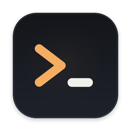

<p align="center">
  
</p>

<h1 align="center">siqi</h1>

<p align="center">
  Fast, native macOS terminal powered by <code>libghostty</code>, SwiftUI, and AppKit.
</p>

## Features

- **GPU-Accelerated Terminal** — Uses `libghostty` via `libghostty-spm` for fast rendering, VT sequence handling, IME input, and 300+ built-in themes.
- **Tabs & Recursive Split Panes** — Create tabs (`⌘T`), split horizontally (`⌘D`) or vertically (`⌘⇧D`), navigate panes (`⌘⌥Arrow`), zoom/unzoom a pane (`⌘⇧↩`), and drag-and-drop tabs between windows.
- **Quick Terminal** — Global hotkey (`⌃\``) drops down a scratchpad terminal above active spaces (requires Accessibility permission for global hotkeys).
- **Window Ergonomics** — Always-on-top pin toggle (`⌘⇧P`), capsule minimize-to-corner mode (`⌘⌥M`), automatic window layout & working-directory persistence across exits (`restore-last-working-directory`), and configurable corner radius.
- **Isolated Configuration** — Reads `~/.config/siqi/config` (with read-only fallback to `~/.config/ghostty/config` on first launch; never mutates Ghostty's config) and supports live hot-reload.

## Keyboard Shortcuts

| Action | Shortcut |
|---|---|
| New Window / Close Window | `⌘N` / `⌘⇧W` |
| New Tab / Close Split or Tab | `⌘T` / `⌘W` |
| Previous / Next Tab | `⌘⇧[` / `⌘⇧]` |
| Switch Tab 1–9 | `⌘1` – `⌘9` |
| Split Right / Split Down | `⌘D` / `⌘⇧D` |
| Focus Adjacent Pane | `⌘⌥↑ ↓ ← →` |
| Toggle Split Zoom / Equalize Splits | `⌘⇧↩` / `⌘⇧=` |
| Quick Terminal | `⌃\`` |
| Find / Next / Previous | `⌘F` / `⌘G` / `⌘⇧G` |
| Clear Scrollback / Restart Session | `⌘K` / `⌘R` |
| Paste Image as File Path | `⌘⌥V` |
| Capsule Mode / Pin Window on Top | `⌘⌥M` / `⌘⇧P` |
| Increase / Decrease / Reset Font Size | `⌘+` / `⌘-` / `⌘0` |
| Open Settings / Config File / Reload | `⌘,` / `⌘⌥,` / `⌘⇧R` |

## Configuration

Siqi reads `~/.config/siqi/config` using Ghostty-compatible `key = value` syntax, plus Siqi extensions (`window-corner-radius`, `restore-last-working-directory`, `ai-tool` / `ai-tools`). Ghostty-compatible keys (`font-family`, `font-size`, `theme`, `background`, `foreground`, `background-opacity`, `background-blur`, `cursor-style`, `cursor-style-blink`, `copy-on-select`, `font-thicken`, `window-padding-x`, `window-padding-y`, `macos-titlebar-style`, `scrollback-limit`, etc.) are supported; Siqi-only keys are stripped cleanly before passing config to `libghostty`.

## Project Structure

```
Sources/
├── App/        # Application lifecycle, menus, entry point
├── Config/     # Configuration parser, watcher, directory persistence
├── Window/     # Multi-window manager, window controllers, Quick Terminal
├── Terminal/   # Session, NSView subclass, split tree, actions, context menu
├── UI/         # SwiftUI views, tab bar, search bar, settings, theme
└── Resources/  # Info.plist, entitlements, Assets.xcassets
Tests/          # XCTest suite
scripts/        # Build, install, and icon utilities
```

## Building & Installing

Requires Xcode 15+, macOS 14.0+, and [XcodeGen](https://github.com/yonaskolb/XcodeGen).

```bash
# Debug build
xcodegen generate
xcodebuild -project siqi.xcodeproj -scheme siqi -configuration Debug -destination 'platform=macOS' build

# Build Universal (arm64 + x86_64) Release app and install to /Applications/siqi.app
# Optionally set SIQI_SIGN_IDENTITY="Developer ID Application: ..." and SIQI_DEVELOPMENT_TEAM="..."
./scripts/install.sh
```

## Distribution Notes

Siqi runs unsandboxed login shells via PTY, inspects child processes (`proc_pidinfo`), monitors global hotkeys for Quick Terminal, and bridges WindowServer background blur. Because of these system-level terminal requirements, **siqi targets direct distribution (Homebrew / signed & notarized DMG) and is not intended for the Mac App Store**.

## Acknowledgments

- [Ghostty](https://ghostty.org) by Mitchell Hashimoto (MIT License) for `libghostty`, core terminal emulation, and built-in color schemes (`GhosttyTheme` / `iTerm2-Color-Schemes`).
- [libghostty-spm](https://github.com/egoist-labs/libghostty-spm) (Copyright (c) 2026 @Lakr233, MIT License) for Swift Package bindings around `libghostty`.
- [MSDisplayLink](https://github.com/Lakr233/MSDisplayLink) (Copyright (c) 2024 Lakr Aream, MIT License) for display link synchronization.

## License

MIT — see [LICENSE](LICENSE).
